# Ryota Ikezawa / paveg

Software Engineer in Japan. Building production-grade middleware for **[Hono](https://hono.dev)** on **[Cloudflare Workers](https://workers.cloudflare.com/)**.

## Featured OSS — Hono Middleware Suite

Production hardening for Hono apps — standard error contracts, safe retries, and webhook verification.

If you find these useful, starring the repos helps others discover them. Issues and PRs welcome.

<a href="https://github.com/paveg/hono-problem-details"><picture><source media="(prefers-color-scheme: dark)" srcset="assets/oss/hono-problem-details-dark.svg"></picture></a>
<a href="https://github.com/paveg/hono-idempotency"><picture><source media="(prefers-color-scheme: dark)" srcset="assets/oss/hono-idempotency-dark.svg"></picture></a>
<a href="https://github.com/paveg/hono-webhook-verify"><picture><source media="(prefers-color-scheme: dark)" srcset="assets/oss/hono-webhook-verify-dark.svg"></picture></a>
<a href="https://github.com/paveg/hono-cf-access"><picture><source media="(prefers-color-scheme: dark)" srcset="assets/oss/hono-cf-access-dark.svg"></picture></a>
<a href="https://github.com/paveg/hono-dpop"><picture><source media="(prefers-color-scheme: dark)" srcset="assets/oss/hono-dpop-dark.svg"></picture></a>

## Elsewhere

- Portfolio: [funailog.com/en/portfolio](https://www.funailog.com/en/portfolio/)
